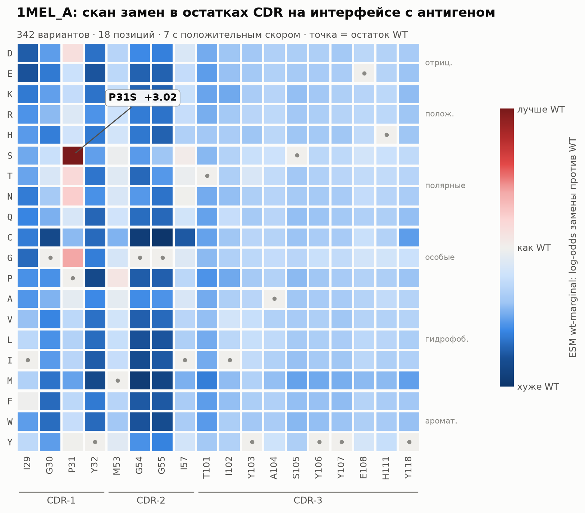

# AI x Antibodies Hackathon (Nucleate Norway, 14.11.2026)

Контекст и чек-лист: [CLAUDE.md](CLAUDE.md)

## Окружение
Intel Mac → PyTorch максимум 2.2.2, Python 3.12, numpy<2.

```bash
uv venv --python 3.12 .venv
uv pip install --python .venv/bin/python -r requirements.txt
source .venv/bin/activate
```

## Важно: SSL для скачивания весов
У Homebrew-Python нет корневых сертификатов, `torch.hub` падает с `CERTIFICATE_VERIFY_FAILED`.
Перед запуском чего-либо, что качает веса:

```bash
export SSL_CERT_FILE=$(python -c "import certifi;print(certifi.where())")
export REQUESTS_CA_BUNDLE=$SSL_CERT_FILE
```

## Нумерация CDR
`abnumber` требует классический ANARCI с HMMER — не ставится без возни.
Вместо него `anarcii` (чистый Python/PyTorch). Обёртка: [src/cdr_tools.py](src/cdr_tools.py).

```bash
.venv/bin/python src/cdr_tools.py
```

## Мини-задача (репетиция пайплайна)
Комплекс антитело-антиген из PDB -> CDR -> остатки на интерфейсе ->
скан точечных мутаций через ESM-2 -> метрики -> CSV в `results/`.

```bash
export SSL_CERT_FILE=$(.venv/bin/python -c "import certifi;print(certifi.where())")
PYTHONPATH=src .venv/bin/python src/mini_task.py 1N8Z B
```

По умолчанию 1N8Z (Fab трастузумаба + HER2). ~1,5 мин на этом ноутбуке,
из них почти всё — загрузка весов ESM-2 в память.

Модули: [src/structure.py](src/structure.py) (PDB, цепи, интерфейс),
[src/metrics.py](src/metrics.py) (ESM wt-marginals, developability),
[src/cdr_tools.py](src/cdr_tools.py) (нумерация, мутации).

Шаблон питча: [PITCH.md](PITCH.md).

### График для слайда
```bash
PYTHONPATH=src .venv/bin/python src/plot_scan.py results/1MEL_A_scan.csv
```
Тепловая карта позиция × аминокислота, светлая и тёмная версии PNG.
Ноль палитры привязан к «как у WT», поэтому красные ячейки сразу читаются
как улучшения. Точка — исходный остаток.



### Что показали два прогона
| | 1N8Z (Fab трастузумаба + HER2) | 1MEL (VHH cAb-Lys3 + лизоцим) |
|---|---|---|
| позиций на интерфейсе | 8 | 18 |
| вариантов | 152 | 342 |
| лучший ESM-скор | −1.04 (`F104S`) | **+3.02** (`P31S`) |

Вывод для субботы: на клинически оптимизированном антителе ESM не находит
улучшений — все скоры отрицательные, модель считает WT лучшим в каждой
контактной позиции. На нанотеле из 1996 года есть положительные скоры.
Значит, подход «одиночные мутации по правдоподобию» работает только на
неоптимизированных последовательностях. Если дадут зрелое антитело —
нужны комбинации мутаций или предиктор, обученный на связывании.

## Структура
- `data/` — входные PDB/последовательности
- `notebooks/` — исследования
- `src/` — пайплайн
- `results/` — кандидаты, метрики, графики
