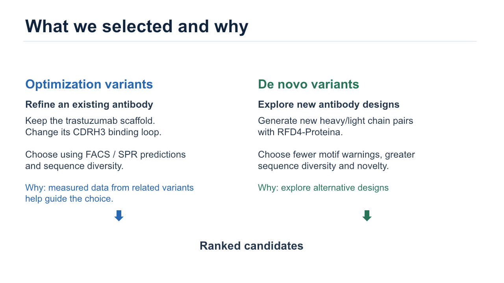
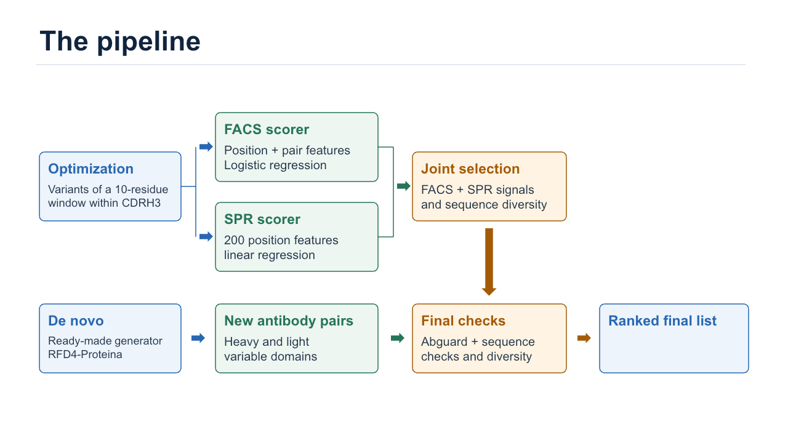
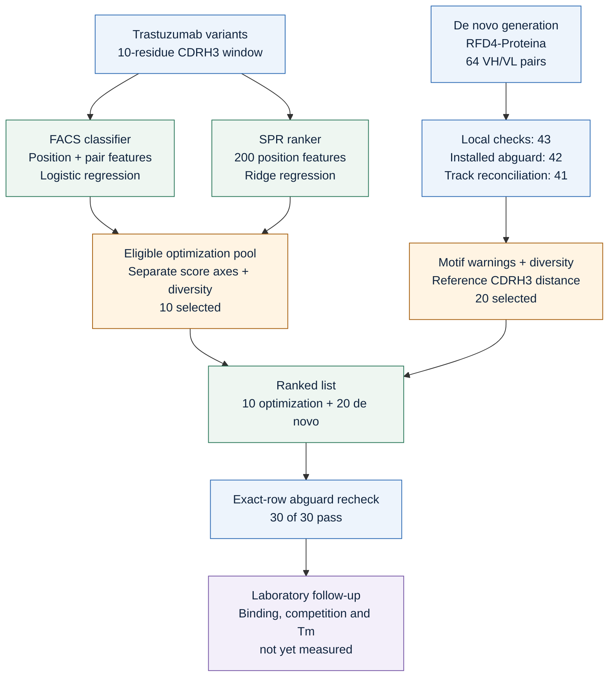

# Epitope Hunters

**Measured data first, new antibody designs second.**

Our AI × Antibodies hackathon project explores two routes to HER2 binders: changing a small region of trastuzumab and generating new antibody pairs with RFD4-Proteina. We prepared a ranked list of **30 candidates: 10 optimization and 20 de novo**.

[Final two-slide pitch](output/selection-slide/her2-selection-and-evidence-en.pptx) · [Team CSV](output/submission-draft/epitope-hunters.csv) · [Pitch narrative](PITCH.md) · [Execution guide](docs/EXECUTION_EN.md) · [Experiment results](docs/EXPERIMENT_INDEX.md)

## Why we took this approach

We came to the challenge with more experience in software and machine learning than in antibody biology. Literature review made the limits clear: a plausible structure or a confident model score does not establish a better antibody. With expensive laboratory experiments and few available slots, we chose to ground our optimization decisions in existing measurements.

The two supplied datasets gave us both evidence and a design boundary. FACS provided screening labels for a large library of trastuzumab variants. SPR provided quantitative binding measurements for a smaller set. We followed that experimental setup: keep the known antibody framework and vary the same ten-residue window within CDRH3. This made our learning problem narrower and our assumptions easier to test. It is why we spent more time on optimization.

For de novo, we used the supplied Apheris RFD4-Proteina workflow and its antibody/HER2 checkpoints to explore new heavy/light chain pairs. It was a relevant, available generator for the challenge. We did not establish that it was the largest or universally best model. Our [training-data inspection](docs/research/rfd4-training-data.md) examined public metadata, not the exact undisclosed training set of the Apheris HER2 fine-tune.

**The result is a reasoned queue of experiments.** All 30 rows passed the installed abguard build. No new candidate has measured affinity, epitope competition or thermal improvement in the evidence preserved here. Submission receipt and organizer acceptance are not recorded.

## The final pitch

These are previews of the exact two-slide file used for the final pitch, as identified by the team. The PowerPoint remains editable.

[](output/selection-slide/her2-selection-and-evidence-en.pptx)

[](output/selection-slide/her2-selection-and-evidence-en.pptx)

The slides use “linear regression” as shorthand. The implemented SPR model is **linear ridge regression with L2 regularization**. The ten residues are a window within CDRH3, not the complete IMGT loop.

## How we selected candidates



### Optimization

The FACS classifier uses individual amino acids and pairs of positions to predict the high-signal class. The SPR ridge uses **10 positions × 20 amino acids = 200 features** to predict `−log10(KD in nM)`. Higher SPR scores predict tighter binding, but candidate KD values remain uncalibrated. The two models predict different experimental outcomes, so we keep their scores separate.

We generated 10,000 statistical proposals. The expanded screen combined 739 statistical candidates with four earlier RFD4 optimization-pilot designs; 124 of these 743 passed the strict gates. Ten diverse candidates were selected from the FACS/SPR Pareto shortlist. The final ranking retains the original positional SPR model; later pairwise and neural comparisons did not change that frozen order. [Scoring report](results/spr-expanded-ranking/report.md).

### De novo

Two RFD4 generation arms produced 64 pairs. Local sequence checks retained 43, and installed abguard accepted 42 of those. We excluded a declared-track/tool-class mismatch and selected 20 from the remaining 41 using motif warnings, paired-sequence diversity and distance from the reference CDRH3 database.

These are eligibility and exploration heuristics, not a validated affinity ranking. Our trastuzumab-specific FACS/SPR scorers were not applied to new antibody frameworks. The first four rows of the combined list contain three optimization candidates and one de novo candidate, reflecting the stronger measured-data basis for optimization. [Selection policy](docs/research/ranked-draft-policy.md).

## What the experiments taught us

| Evidence | What we tested | What we retained |
| --- | --- | --- |
| FACS: 524,346 variants | Published train/validation/test splits; positional and pairwise classifiers | Pairwise logistic test AP **0.9737** for the high class. This is a screening endpoint, not KD |
| SPR: 158 eligible variants, including 75 distant variants | Grouped nested evaluation of numeric KD ranking | Positional ridge Spearman **0.613**, falling to **0.425** in the distant subset. Candidate improvement over WT remains unproven |
| External SPR: 36 controls, 25 numeric KDs | Transfer to a separate measured panel | A limited retrospective check, with broad uncertainty |
| Neural models and 100,000 synthetic examples | MLPs, Transformers, embeddings, pseudo-labels and SPR adaptation | Better FACS classification did not establish better affinity ranking. No neural model replaced the final selector |
| Structural models | Known-complex controls, repeated seeds and target contexts | The tested setups did not justify candidate ranking. High ipTM alone was not a selection rule |
| Thermal stability | Dataset audit and a ThermoMPNN-D control pilot | No supported candidate Tm ranking. Thermal evidence remains missing |
| Installed abguard | Exact final rows, package and reference provenance | **30/30** passed that build. This is eligibility, not binding or final organizer approval |

The 75 distant SPR variants are a subset of the 158, not another independent cohort. Many model comparisons reuse those outcomes. Structural repeats count predicted poses, not independent molecules. [Full experiment index and limitations](docs/EXPERIMENT_INDEX.md).

## Reproduce the final selection

Selection replay uses committed evidence, needs no GPU or API credentials and does not submit designs. In a fresh checkout:

```bash
python3 -m venv .venv
source .venv/bin/activate
python -m pip install 'rapidfuzz>=3.14,<4'
python -m scripts.prepare_ranked_draft --output /tmp/epitope-hunters-replayed.csv
cmp /tmp/epitope-hunters-replayed.csv output/submission-draft/epitope-hunters.csv
```

Use a new output filename on each run. This reproduces the ranking from archived validator evidence; it does not rerun abguard or the laboratory experiments.

For CPU tests, install the same dependencies as [CI](.github/workflows/tests.yml) and run `PYTHONPATH=.:src pytest -q tests`. For model training, provider generation or raw structure audits, see [setup](docs/SETUP.md), the [execution guide](docs/EXECUTION_EN.md) and [data retention and restoration](docs/DATA_RETENTION.md). Organizer data and provider access may no longer be available after the event. Archived evidence supports local review independently of that infrastructure.

## Repository map

| Path | Contents |
| --- | --- |
| [`output/selection-slide/`](output/selection-slide/) | Final two-slide pitch and exact previews |
| [`output/submission-draft/`](output/submission-draft/) | Team-named CSV, frozen source pools and validation evidence |
| [`src/`](src/) and [`scripts/`](scripts/) | Models, generation wrappers, audits and deterministic selection |
| [`docs/EXPERIMENT_INDEX.md`](docs/EXPERIMENT_INDEX.md) | Findings, limitations and links to each experiment |
| [`docs/research/`](docs/research/) | Literature notes, protocols and focused result reports |
| [`results/`](results/) | Scores, manifests, reports and compressed evidence archives |
| [`docs/archive/`](docs/archive/) | Earlier overview and presentation drafts |

[English plain-language explanation](docs/PIPELINE_EXPLAINED_EN.md) · [Russian explanation](docs/PIPELINE_EXPLAINED_RU.md) · [PDF guides](output/pdf/README.md)

The plain-language guides and earlier decks are dated research snapshots. The final pitch above is the presentation of record. Historical setup and planning documents record changing assumptions; the result reports and final selection policy take precedence when they differ.
