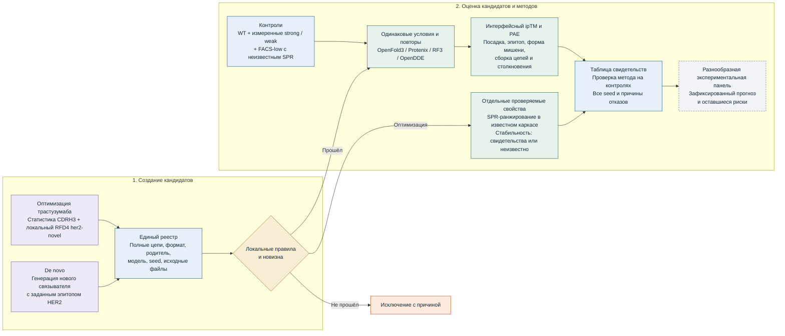

# Единый стенд создания и оценки молекул

Стенд помогает выбрать ограниченную панель для лаборатории. Это две связанные системы: генерация предлагает молекулы, а фиксированный набор проверок оценивает их наравне с известными контролями. Прогнозы не записываются как новые лабораторные измерения.

## Два пайплайна



[Словарь терминов и подробная схема](SELECTION_PIPELINE_RU.md).

## Что уже работает

Последний снимок включает [53 исследовательских кандидата в формате организаторов](../output/submission-draft/README.md) для обоих треков и [два слайда о пайплайнах](../output/pipeline-draft/README.md). У 43 de novo проверены происхождение генерации и локальные правила; 10 вариантов оптимизации взяты из ранее замороженного списка. Формат CSV и `immunum` не заменяют официальный `abguard` и его базу новизны.

| Новая проверка | Наблюдение | Решение |
| --- | --- | --- |
| Внешняя серия Absci | 36 совместимых контролей без точных пересечений, 25 с численным KD; ridge ROC AUC 0.833, Spearman 0.492 | Перенос сигнала есть в этой небольшой серии, превосходство над FACS не установлено; на далёком поднаборе detection AUC 0.548 |
| Полный шаблон HER2 без MSA | 48 поз в сравнении полного и маскированного шаблонов; WT top-1 прошёл в 1/3 и 0/3 seed | Ни один вариант не достиг порога 2/3 |
| Полный шаблон с target MSA | Ещё 24 позы; WT прошёл в 0/3 seed | Новую кандидатную панель не запускать с этой постановкой |
| Смеси Transformer и ridge | Есть более высокие точечные оценки на далёких вариантах, но интервалы различий включают ноль | Не менять приоритеты по этому диагностическому результату |

Это проверка воспроизведения известной геометрии, а не калибровка вероятности связывания. Неудача метода на WT не доказывает, что наши кандидаты не связываются. [Полный структурный отчёт](research/template-controls-results.md), [внешняя SPR-проверка](research/external-spr-results.md), [смеси моделей](research/hybrid-spr-results.md).

Сборка общей таблицы из сохранённых аудитов не вызывает платные API и не запускает новые предсказания:

```bash
source .venv/bin/activate
PYTHONPATH=.:src python -m scripts.build_evaluation_board
```

Результат: [таблица кандидатов](../results/evaluation-board/candidates.csv), [контроли](../results/evaluation-board/controls.csv), [все структурные строки](../results/evaluation-board/structures.csv), [читаемый отчёт](../results/evaluation-board/report.md) и [хеши источников](../results/evaluation-board/manifest.json). Это снимок текущей исследовательской панели, не отправка в лабораторию или на конкурс. Старые строки OpenFold3/Protenix содержат confidence без пересчитанной геометрии; пропуск контактов там остаётся пропуском, не нулём.

Генерация и допуск реализованы в `src/her2_candidates.py`, `scripts/expand_spr_screen.py`, `scripts/run_design_pilot.sh` и `scripts/prepare_denovo.py`; команды и ограничения данных описаны в [плане кампании](CAMPAIGN.md). Результаты разных генераторов поступают в общий реестр после проверки полных цепей и формата. RFD4 `her2-novel` на VM отличается от публичного RFD4 в облачных каталогах. Их нельзя считать одним чекпойнтом. [Аудит возможностей](research/model-capability-audit.md).

## Правила сравнения

| Вопрос | Набор и сравнение | Допустимый вывод |
| --- | --- | --- |
| Узнали ли мы FACS-сигнал? | Опубликованные train / validation / test, сравнение одинаковых архитектурных бюджетов | Качество классификации сигнала в этой библиотеке |
| Помогает ли это выбирать аффинность? | 158 реальных SPR-вариантов, групповые внешние и внутренние фолды; отдельно 75 далёких вариантов | Ретроспективное ранжирование KD в фиксированном каркасе |
| Правдоподобна ли структура? | Одинаковые контроли и входы, полные цепи, заданный контекст HER2, все запланированные seed | Геометрическая согласованность и уверенность выбранной постановки |
| Тот ли участок узнаётся? | Контакты относительно экспериментальной структуры и повторяемость посадки | Структурная гипотеза о сохранении эпитопа |
| Стала ли молекула термостабильнее? | Проверенный на подходящих измерениях прокси либо явное отсутствие такого свидетельства | Тепловой прогноз только в проверенной области применимости |
| Достоин ли кандидат лабораторной попытки? | Допуск, несколько отдельных свидетельств, неопределённость и разнообразие панели | Обоснованный приоритет исследования, без гарантии трёх лабораторных исходов |

ipTM входит в структурную часть. У парного антитела отдельно учитываем VH–VL и антитело–HER2: хороший первый интерфейс может скрыть плохой второй. Скалярный максимум между несколькими парами зависит от числа цепей, поэтому контексты мишени не смешиваем. Если метод не воспроизводит WT, это ослабляет свидетельство от данного метода, а не доказывает отсутствие связывания у всех кандидатов. На текущем стенде нет подтверждённой универсальной вероятности успеха или общего взвешенного балла.

По каждому кандидатному ID сохраняются источник генерации, полная последовательность, локальный допуск, расхождение моделей, доля удачных повторов по заранее описанной геометрии, пропуски и причина приоритета. Разные модели могут разделять архитектуры, обучающие структуры и ошибки. Подбирать лучший seed или лучший crop по финалисту после просмотра результата нельзя выдавать за фиксированный бенчмарк.

## Как расширяем данные

1. Реальные измерения хранятся с источником, конструкцией, единицами, повторами и типом исхода. Внешняя серия допускается к сравнению после проверки цепей, формата и пересечений с обучением. [Исследование внешних наборов](research/benchmark-evidence.md).
2. Синтетические последовательности и псевдометки находятся отдельно. Уже проведён эксперимент с 100000 примеров; он не дал устойчивого улучшения SPR. Такие записи не попадают в тестовые лабораторные метки. [Результаты нейросетей](research/neural-results.md).
3. Генеративные структуры и модельные confidence могут учить дешёвый предиктор согласованности с учителем. Для заявления о переносе на аффинность или Tm нужна отдельная проверка на реальных измерениях. Увеличение числа модельных меток само по себе не увеличивает независимую экспериментальную информацию.

Текущий основной статистический ориентир остаётся прямой SPR ridge; парные признаки дают дополнительную исследовательскую гипотезу. Transformer/MLP, синтетический вариант и фиксированные смеси сохраняются как выполненные абляции. Внешняя SPR-проверка и структурное сравнение шаблонов завершены. Следующая структурная гипотеза должна снова пройти контроли до оценки финалистов. В частности, текущий crop обрывает дисульфид 626–634, поэтому границы мишени требуют отдельной проверки, без обещания, что это устранит ошибки. Термостабильность остаётся нерешённой осью.
