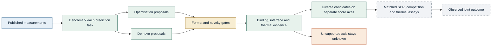

# Whole-task experiment decisions

14 November 2026. Both tracks are research experiments. No competition submission or synthesis order has been made. There is no established S-tier design.

## What the benchmark needs to answer

| Question | Current evidence | Decision |
| --- | --- | --- |
| Can we identify FACS-high variants? | Published test AP 0.9737; novelty-distance diagnostic is harder and smaller | Use FACS as a binding-screen signal within the trastuzumab background |
| Can we rank measured affinity? | Grouped SPR ridge rho 0.613 versus FACS 0.347; on 75 distant variants 0.425 versus 0.197, with difference interval crossing zero | Retain two separate axes; absolute WT KD calibration fails |
| Do proposals pass local rules? | 124 strict passes among 743 deliberately screened proposals | Local validity is necessary; official validation remains pending |
| Does the model recover the intended interface? | Target-only prediction has a low-confidence WT interface; a FACS-low control can score higher | Audit target context and use measured controls before ranking by geometry |
| Does greater sequence novelty preserve folding? | k1 yields 4/4 below two local reference identities, one extra cysteine and weaker VH/VL confidence | Evaluate usable yield, not novelty alone; no database-wide claim |
| Can we prioritize thermal improvement computationally? | ThermoMPNN-D fails some measured controls and does not improve panel ranking over mutation count | Keep thermal evidence missing; investigate measured stabilizing mutations as hypotheses |
| Can we predict all three contest outcomes jointly? | No matched prospective SPR, competition and thermal labels for our designs | No calibrated S-tier probability or weighted universal score |

## Controlled comparisons

Keep seed lists, target sequence, format, template mode and sample count fixed within a comparison. Preserve all samples and failed attempts. Report per-attempt yield and distinct sequence-family yield. The 10,000 statistical proposals and four-design generator pilots have different budgets and selection mechanisms; their observed counts are not a fair method leaderboard.

The structural control panel should contain WT plus the strongest and weakest quantified SPR variants in the same scaffold. FACS-low is an additional screen control, not a measured nonbinder. WT pose recovery is a geometry check, not a blind test on a protein unseen by pretrained models. Full target context and split-crop comparisons should use coordinates from the same source so geometry and sequence continuity are not confounded.

After a useful reference panel is established, compare a small number of optimisation and de novo candidates under the same settings. At least one additional seed is needed to assess sampling sensitivity. Agreement between models from the same family is correlated evidence; it must not be counted as independent votes.

## Selection and stopping rules

1. Exclude local format failures and retain the exact reason. Preserve official validation as pending.
2. For optimisation, compare FACS rank, SPR rank, distance from training families and fit sensitivity. Do not map a high class probability to KD or transfer it to a modified VL.
3. Keep target contacts separate from VH/VL assembly. If WT controls cannot recover the interface or the model cannot distinguish the relevant controls, suspend that structural ranking rule.
4. Use thermal predictions only after matched controls support the intended endpoint. The current proxy did not pass this check. A published stabilizing mutation is evidence for its measured parent, not its combination with a new H3.
5. Select a diverse review list across plausible tradeoffs. A larger pool is justified only if it yields new eligible families with evidence beyond the existing pool.
6. Before eventual lab work, freeze predictions and success criteria. Joint success requires measured binding, competition and thermal improvement against the specified reference. Four guaranteed slots are too few to establish a reliable general hit rate.

## Sources and artifacts

[Benchmark and commands](BENCHMARK.md), [provider paper review](research/provider-papers.md), [expanded optimisation ranking](../results/spr-expanded-ranking/report.md), [de novo refold scores](../results/denovo-refold/scores.csv), [thermal control pilot](../results/thermal-pilot/README.md), [stability combination hypothesis](research/stability-combination.md) and [visual explainer](../output/explainer/her2-intuition.pdf).
