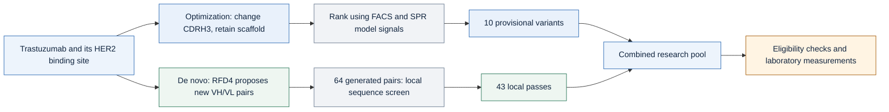
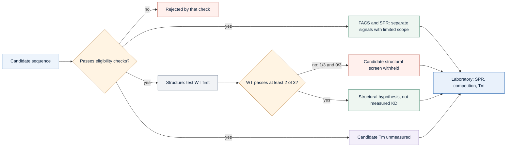

# A plain-language guide to the two pipeline slides

This guide accompanies the two English [presentation slides](../output/pipeline-draft/her2-hackathon-pipeline-draft-v8.pptx). Here, a “candidate” is a sequence worth investigating. No newly designed molecule has demonstrated an improvement in the laboratory yet.

## Slide 1. How we generate antibody variants

HER2 is a protein on the surface of some cells. Trastuzumab is an antibody that binds HER2. The patch on HER2 that it attaches to is the **epitope**. The antibody surface that recognizes that patch is the **paratope**. Both design routes aim to preserve recognition of the same HER2 site.

The slide shows two ways to propose candidates:

- **Optimization:** retain the trastuzumab scaffold and change a ten-amino-acid window within its CDRH3 loop. This loop forms part of the paratope. We provisionally rank sequences using FACS data and a model trained on measured SPR data. This selected ten variants for investigation; it did not establish ten improvements.
- **De novo:** ask RFD4 to generate new pairs of heavy- and light-chain variable domains (VH/VL), directed toward the trastuzumab binding-site context. Of 64 generated pairs, 43 passed our local sequence checks. This is a sequence and provenance screen, not a binding assay.

**Eligibility and tracks are separate.** The installed `abguard` accepted 52 of the 53 sequences in the research pool. Its internal classes are 11 `novel` and 41 `de_novo`. These are diagnostic classes from that tool build, not the explicit submission track or proof of binding. Across all 64 RFD4 sequences, the same tool accepted 21/32 in one generation arm and 26/32 in the other. Final acceptance by the organizers is unknown. See the [abguard audit](research/abguard-validation.md) and [experiment index](EXPERIMENT_INDEX.md).

The latest organizer update requires both tracks in **one CSV with six columns**: the original five fields `sequence_id, kind, heavy_sequence, light_sequence, design_description`, plus an explicit `track` set to `optimization` or `denovo`. Submit at least 28 designs, preferably about 30, in priority order: the laboratory will take the first N rows. This replaces the PDF's earlier limit of 20. The four guaranteed tests are shared across the team, not four per track; bonuses can raise the allocation to 28. Priority is repeated in `design_description`. The file goes only in the team's own channel, tagging Davide. **No submission has been made.**

The current ranked review draft contains **30 designs: 10 optimization and 20 de novo**. All 30 passed the installed validator. The first four rows contain three optimization variants and one de novo design. A declared-track/internal-class mismatch was excluded. These priorities are provisional choices, not measured biological superiority. See the [draft and selection policy](../output/submission-draft/README.md).

## Slide 2. What the checks tell us, and what remains unknown

First, separate **sequence eligibility** from biological performance. Checking length, format, numbering and cysteines asks whether a record meets the rules. It does not answer whether the antibody binds HER2.

| Dataset | Available evidence | How to interpret it |
|---|---|---|
| FACS CDRH3 variants | 524,346 | Sorting-signal classes, not measured KD |
| Internal SPR | 768 rows, 190 with KD, 158 variants in evaluation | Binding measurements; the 158-variant cohort reflects exclusions and overlap checks |
| External SPR controls | 36, including 25 numerical KDs | A limited check of transfer to another dataset |
| RFD4 | 64 paired designs | Computer-generated sequences, not laboratory results |
| Synthetic dataset | 100,000 sequences | Computer-generated examples and labels; they add no experimental evidence |

The FACS model distinguishes classes reflecting the sorting signal. **KD** from SPR is more directly related to binding strength: a lower KD means tighter binding. On 158 selected variants, the SPR model's ranking agreed moderately with measurements (Spearman ρ=0.613). This is a retrospective evaluation on the trastuzumab scaffold. It does not validate absolute KD predictions for new candidates and does not automatically transfer to de novo designs.

**ipTM measures model confidence in how protein chains are positioned relative to each other. It is not affinity or KD.** A model can confidently predict an interface and still be wrong about binding. We therefore first checked a known control. The structural gate required success in at least two of three runs. Trastuzumab passed 1/3 without MSA and 0/3 with target MSA. The gate failed, so both candidate structural screens were withheld. This limits confidence in that evaluation setup; it does not itself prove that a candidate fails to bind.

**Tm** is a protein's thermal unfolding transition temperature. A higher Tm is desirable for thermal stability under comparable measurement conditions. Candidate Tm has not been measured; neither the structure nor the models currently justify an improvement claim. Three separate laboratory checks are needed: SPR for binding, competition with trastuzumab for epitope preservation and a direct Tm measurement.

Sources: [experiment index](EXPERIMENT_INDEX.md), [structural controls](research/template-controls-results.md), [external SPR](research/external-spr-results.md), [thermal assessment](research/thermal-assessment.md) and [submission rules audit](research/submission-rules-audit.md). The [slide README](../output/pipeline-draft/README.md) also records the figures and limitations.

## Short speaking notes

**Slide 1, about one minute.** “We are exploring two routes to an antibody against HER2. For optimization, we retain the trastuzumab scaffold and change a ten-amino-acid window in its CDRH3 loop. FACS and SPR data help select variants, but do not yet prove anything about the new molecules. In the other route, RFD4 generated 64 new chain pairs; 43 passed local sequence checks. Abguard separately checks eligibility, but its internal novel and de_novo labels are not the declared competition tracks. The updated CSV includes an explicit track field. This is a queue for further evaluation, not a list of demonstrated improvements.”

**Slide 2, about one minute.** “We separate three questions. FACS helps identify sorting-signal classes, while SPR measures KD: lower means tighter binding. ipTM describes confidence in chain placement, not measured affinity. For known trastuzumab, our structural control passed only one of three runs without MSA and none with target MSA, against a requirement of two of three. We therefore do not rely on those candidate structural screens. We also do not infer thermal stability from a structure: candidate Tm remains unknown. Separate laboratory assays must establish KD, competition with trastuzumab and Tm.”

## Short glossary

- **HER2:** the protein target on the cell surface.
- **Epitope / paratope:** the target's binding patch / the antibody surface that recognizes it.
- **CDRH3:** a variable loop in the antibody heavy chain. We change a ten-residue window; the full WT loop has 13 residues under IMGT numbering.
- **VH / VL:** heavy- / light-chain variable domains.
- **FACS:** fluorescence-activated cell sorting.
- **SPR:** surface plasmon resonance, a laboratory method for measuring molecular interactions.
- **KD:** the dissociation constant; a lower value generally means tighter binding.
- **ipTM:** interface predicted TM score, a measure of confidence in relative chain placement, not measured binding strength.
- **Tm:** thermal unfolding transition temperature; higher indicates greater thermal stability in a comparable assay.
- **MSA:** multiple sequence alignment, which provides related-sequence information to some structure models.
- **RFD4 / abguard:** a protein-design generator / a sequence eligibility validator.
