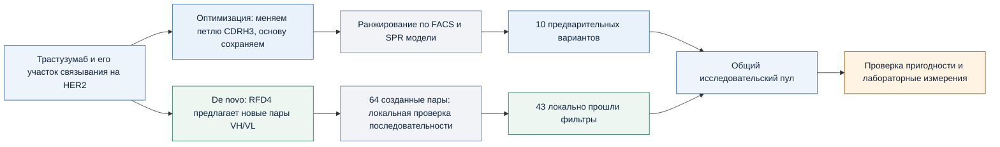
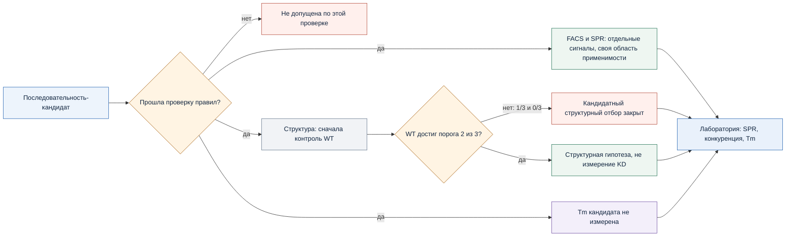

# Пояснение к двум слайдам о пайплайне

Это русское сопровождение к двум английским слайдам в [презентации](../output/pipeline-draft/her2-hackathon-pipeline-draft-v8.pptx). Здесь «кандидат» означает пока только последовательность, которую стоит проверить. Ни один новый дизайн ещё не показал улучшения в лаборатории.

## Слайд 1. Как получаем варианты антител

HER2 — белок на поверхности некоторых клеток. Трастузумаб — антитело, которое связывается с HER2. Участок HER2, к которому оно прикрепляется, называется **эпитопом**. Поверхность антитела, которая его распознаёт, — **паратоп**. Цель обеих веток — найти варианты, которые сохраняют узнавание того же участка HER2.

На слайде показаны два способа предложить варианты:

- **Оптимизация:** оставляем основу трастузумаба и меняем десятиаминокислотное окно внутри петли CDRH3. Это один из участков паратопа. Последовательности предварительно ранжируем по данным FACS и по модели, обученной на измерениях SPR. Так выбраны десять вариантов для изучения, а не доказаны десять улучшений.
- **De novo:** просим RFD4 создать новые пары вариабельных доменов тяжёлой и лёгкой цепей (VH/VL), ориентированные на область связывания трастузумаба. Из 64 созданных пар 43 прошли наши локальные проверки последовательности. Это фильтр пригодности и происхождения, а не тест связывания.

**Важно про допуск и треки.** В текущем исследовательском пуле установленный `abguard` пропустил 52 из 53 последовательностей: классы инструмента — 11 `novel` и 41 `de_novo`. Это диагностические классы конкретной версии инструмента, не конкурсное назначение трека и не доказательство связывания. На всех 64 RFD4-последовательностях эта версия пропустила 21/32 в первом генерационном плече и 26/32 во втором. Официальное принятие организаторами неизвестно. Основание: [проверка abguard](research/abguard-validation.md) и [индекс экспериментов](EXPERIMENT_INDEX.md).

По последнему обновлению организаторов оба трека идут в **одном CSV из шести колонок**: пять прежних полей `sequence_id, kind, heavy_sequence, light_sequence, design_description` плюс явное поле `track` со значением `optimization` или `denovo`. В одном файле можно указать оба трека. По более позднему уточнению организаторов нужно подать минимум 28 дизайнов, лучше около 30, в порядке приоритета: лаборатория возьмёт первые N строк. Это заменяет прежнее ограничение PDF до 20. Четыре гарантированных теста — на всю команду, не по четыре на трек; с бонусами можно получить до 28. Приоритет дублируем в design_description. CSV следует отправлять только в собственный командный канал и отметить Davide. **Подача не выполнялась.**

Текущий ранжированный черновик содержит **30 дизайнов: 10 оптимизации и 20 de novo**. Все 30 прошли установленный валидатор. Первые четыре строки содержат три варианта оптимизации и один de novo. Дизайн с конфликтом заявленного трека и внутреннего класса инструмента исключён. Приоритеты означают предварительный порядок выбора, а не измеренное биологическое превосходство. [Черновик и правила отбора](../output/submission-draft/README.md).

## Слайд 2. Что говорят проверки, а чего пока не знают

Сначала отделяем **допуск последовательности** от биологического результата: проверка длины, формата, нумерации и цистеинов отвечает, подходит ли запись под правила. Она не отвечает, связывает ли антитело HER2.

| Данные | Что есть | Как читать |
|---|---:|---|
| FACS-варианты CDRH3 | 524 346 | Классы сигнала сортировки; это не измерение KD |
| Внутренний SPR | 768 строк, 190 с KD, 158 вариантов в оценке | Измерения силы связывания; отбор 158 учитывает исключения и пересечения |
| Внешние SPR-контроли | 36, из них 25 с числовым KD | Ограниченная проверка переноса модели на другой набор |
| RFD4 | 64 парных дизайна | Компьютерно созданные последовательности, не лабораторные результаты |
| Синтетический набор | 100 000 последовательностей | Синтетические примеры с компьютерными метками; экспериментальных доказательств не добавляют |

В FACS модель различает классы, которые отражают сигнал сортировки. Прямее к силе связывания относится **KD** из SPR: меньший KD означает более прочное связывание. На 158 отобранных вариантах ранжирование SPR-модели согласовывалось с измерениями (ρ=0,613), но это ретроспективный тест на вариантах с каркасом трастузумаба. Он не подтверждает абсолютный KD новых дизайнов и не переносится автоматически на de novo.

**ipTM — уверенность модели в расположении белковых цепей друг относительно друга. Это не аффинность и не KD.** Модель может уверенно построить интерфейс и ошибиться в реальном связывании. Поэтому сперва проверили известный контроль: при пороге структуры не ниже 2 успешных запусков из 3 трастузумаб прошёл 1/3 запусков без MSA и 0/3 с MSA для мишени. Порог не достигнут, поэтому оба структурных отбора кандидатов остановлены. Это ограничивает доверие к данному структурному тесту, но само по себе не доказывает, что кандидат не связывается.

**Tm** — температура, при которой белок теряет свою упорядоченную структуру. Более высокая Tm желательна для термостабильности. Для новых кандидатов Tm не измеряли; ни структура, ни модель не дают здесь основания заявлять улучшение. Нужны три отдельные лабораторные проверки: SPR для связывания, конкуренция с трастузумабом для сохранения эпитопа и прямое измерение Tm.

Источники: [экспериментальный индекс](EXPERIMENT_INDEX.md), [структурные контроли](research/template-controls-results.md), [внешний SPR](research/external-spr-results.md), [оценка данных по термостабильности](research/thermal-assessment.md), [аудит правил подачи](research/submission-rules-audit.md). Числа и оговорки к слайдам также собраны в [README презентации](../output/pipeline-draft/README.md).

## Короткий текст для выступления

**Слайд 1, около минуты.** «Мы исследуем два пути к антителу против HER2. В оптимизации сохраняем основу трастузумаба и меняем десятиаминокислотное окно его петли CDRH3. Данные FACS и SPR помогают отобрать варианты, но пока ничего не доказывают о новых молекулах. Во второй ветке RFD4 создал 64 новые пары цепей; 43 прошли локальную проверку последовательности. Проверка abguard отдельно оценивает соответствие части правил, но его метки novel и de_novo не являются конкурсными треками. По обновлённым правилам трек будет явно записан в общем CSV. Это очередь для последующих проверок, не список уже доказанных улучшений».

**Слайд 2, около минуты.** «Мы разделяем три вопроса. FACS помогает распознавать класс сигнала, а SPR измеряет KD: чем он ниже, тем прочнее связывание. ipTM показывает уверенность модели в расположении цепей, но не измеряет аффинность. На известном трастузумабе структурный контроль прошёл только один запуск из трёх без MSA и ни одного из трёх с MSA, при требовании два из трёх, поэтому на этот структурный отбор кандидатов мы не опираемся. Термостабильность тоже не предсказываем по структуре: Tm кандидатов неизвестна. Итог должны дать отдельные лабораторные тесты на KD, конкуренцию с трастузумабом и Tm».

## Мини-глоссарий

- **HER2:** белок-мишень на поверхности клеток.
- **Эпитоп / паратоп:** участок мишени / участок антитела, который его распознаёт.
- **CDRH3:** изменяемая петля тяжёлой цепи антитела; здесь изменяем окно из 10 аминокислот; полная петля по нумерации IMGT содержит 13.
- **VH / VL:** вариабельные домены тяжёлой / лёгкой цепи.
- **FACS:** сортировка клеток по измеренному флуоресцентному сигналу.
- **SPR:** лабораторный метод измерения взаимодействия молекул.
- **KD:** константа диссоциации; меньшее значение обычно означает более прочное связывание.
- **ipTM:** оценка уверенности модели в контакте цепей, не измеренная сила связывания.
- **Tm:** температура плавления белка; более высокая Tm означает большую термостабильность в сопоставимом измерении.
- **MSA:** выравнивание родственных последовательностей; модели иногда используют его как дополнительную подсказку о структуре.
- **RFD4 / abguard:** инструмент генерации белковых дизайнов / инструмент проверки последовательности по части правил допуска.
