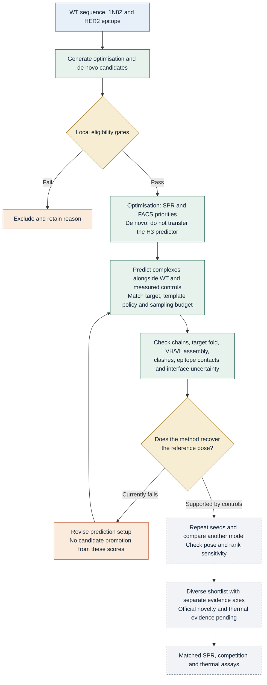

# Current selection pipeline

The pipeline supports local eligibility checks, retrospective affinity prioritisation in the trastuzumab background and structural failure diagnosis. It does not yet validate a reliable structural ranking of new binders. The latest WT cofolding controls failed pose recovery, and thermal evidence for new candidates remains missing.

Local gates cover format, length, numbering, cysteines and known-sequence distance. Passing them does not establish acceptance by the unavailable official database gate. Interface scores are not KD. Structural epitope overlap does not prove competition. There is no calibrated universal score combining these axes.

The matched domain IV Protenix WT recovered 3/19 footprint positions, while `YTGDGFPAMN` recovered 16/19 in one draw. That attractive candidate pose is a follow-up hypothesis, not sufficient evidence for promotion when the controls fail. Full ECD did not rescue the panel. RF3 recovered more WT contacts but distorted the target. [Structural audit](research/context-results.md).

Pairwise ridge and frozen AbLang2 provide additional retrospective affinity hypotheses, with no established improvement over the simple position baseline in the distant subset. [Comparison](research/ablang-benchmark.md). ThermoMPNN-D did not support thermal ranking. [Thermal controls](../results/thermal-pilot/README.md).
