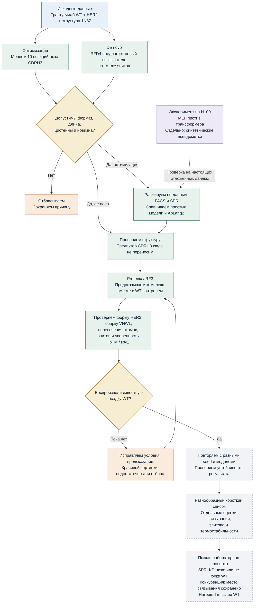

# Как мы выбираем кандидатов

Мы ищем молекулу, которая достаточно сильно держится за нужное место HER2 и лучше переносит нагрев. Сейчас работает проверка допустимости и статистическое ранжирование вариантов трастузумаба. Структурная проверка пока не восстановила известный комплекс достаточно надёжно, а улучшение термостабильности новых кандидатов не подтверждено.

Зелёное означает выполненный вычислительный этап, а не доказанный успех молекулы. Жёлтое означает проверку, оранжевое показывает текущую проблему, фиолетовое обозначает эксперимент и серое показывает следующие этапы. Конкурсных подач и заказов синтеза не делаем.

## Что означает каждый термин

| Термин | Интуиция и роль |
| --- | --- |
| Антитело, трастузумаб | Антитело является белком, способным узнавать другую молекулу. Трастузумаб является нашим исходным антителом против HER2. |
| HER2 | Human epidermal growth factor receptor 2, белок на поверхности клетки и наша мишень. |
| WT | Wild type. В нашем эксперименте так обозначаем исходную последовательность трастузумаба, контроль для сравнений. |
| 1N8Z | Идентификатор экспериментально определённой структуры комплекса трастузумаба с HER2 в Protein Data Bank. Даёт эталон взаимного расположения. |
| Эпитоп | Участок поверхности HER2, к которому прикладывается антитело. Нам нужно сохранить узнавание этого участка. |
| Паратоп | Контактная поверхность самого антитела. Эпитоп и паратоп являются двумя сторонами одного контакта. |
| Аминокислота, остаток | Один элемент белковой цепи, обычно записываемый одной буквой. Последовательность влияет на форму и химические свойства поверхности. |
| VH / VL | Variable heavy / variable light, переменные области тяжёлой и лёгкой цепей антитела. Вместе формируют связывающую часть трастузумаба. |
| CDRH3 | Complementarity-determining region 3 тяжёлой цепи, одна из контактных петель. В выданной библиотеке меняются 10 позиций внутри этой области; это окно не равно всем определениям CDRH3 в схемах нумерации. |
| Оптимизация | Меняем часть известного антитела и пытаемся улучшить свойства, сохранив полезное исходное узнавание. |
| De novo | Проектируем новый связыватель. Статистика короткой петли в одном фиксированном антителе не становится автоматически предиктором для нового каркаса. |
| RFD4 | Название используемой модели генерации RFD4-Proteina. Предлагает варианты молекул; генерация сама по себе не доказывает связывание. |
| Цистеин | Аминокислота, способная образовывать дисульфидную связь с другим цистеином. Проверяем ограничения на непарные цистеины. |
| Новизна | Достаточное отличие последовательности от исходного антитела и известных последовательностей по правилам трека. Локальная проверка не заменяет закрытую базу организаторов. |
| FACS | Fluorescence-activated cell sorting, сортировка клеток по флуоресценции. Наши метки high / mid / low отражают классы сигнала в таком эксперименте, а не прямое измерение KD. |
| SPR | Surface plasmon resonance, поверхностный плазмонный резонанс. Метод измерения взаимодействия, позволяющий оценить KD при заданных условиях. |
| Аффинность и KD | Аффинность описывает силу связывания. KD является равновесной константой диссоциации: меньше KD обычно означает более сильное связывание. Сравниваем одинаковые форматы и условия измерения. |
| AbLang2 | Предобученная модель последовательностей антител. Мы уже использовали её замороженные числовые представления и обучали поверх них небольшой предиктор SPR. |
| MLP | Multilayer perceptron, обычная многослойная нейросеть. Служит контролем для трансформера, чтобы проверить вклад attention при близком числе параметров. |
| Трансформер и attention | Модель, в которой представление одной позиции зависит от других позиций. Attention обучается распределять вес информации между ними; его веса не являются картой физических контактов. |
| Псевдометки | Вероятности классов, выданные моделью синтетическим последовательностям. Это гипотезы учителя, а не лабораторные наблюдения. |
| Отложенные данные, бенчмарк | Заранее определённые данные и правила сравнения. На тесте оцениваем модель, не обучаем её и не выбираем лучший момент остановки. Наша текущая оценка ретроспективна: набор уже использовался при разработке. |
| Protenix / RF3 | Модели предсказания структуры комплекса. RF3 означает RoseTTAFold3. Проверяем их на исходном известном комплексе, прежде чем доверять оценкам новых молекул. |
| ipTM | Interface predicted TM-score, оценка уверенности модели во взаимном расположении цепей. Выше обычно лучше для уверенности, но это не аффинность и не вероятность лабораторного успеха. |
| PAE | Predicted aligned error, ожидаемая ошибка относительного положения частей структуры после выравнивания. Ниже обычно лучше; это внутренняя оценка модели, а не измеренная ошибка. |
| Seed | Начальное значение генератора случайных чисел. Повторы с разными seed показывают, насколько результат зависит от случайной инициализации или сэмплирования. |
| Термостабильность и Tm | Устойчивость структуры белка к нагреву. Tm является температурой наблюдаемого перехода разворачивания в заданном эксперименте. Выше обычно лучше, но формат молекулы и условия должны совпадать. |
| Конкурентное связывание | Проверяем, мешает ли новый связыватель трастузумабу связываться с HER2. Это проверка перекрывающегося узнавания; она не доказывает совпадение каждого атомного контакта. |
| H100, GPU, VM | H100 является вычислительным ускорителем NVIDIA; GPU означает графический процессор, используемый для матричных вычислений; VM означает удалённую виртуальную машину с этим ускорителем. |

Главная цель имеет три оси: **KD не хуже исходного, узнаваемый участок сохранён и Tm выше исходного**. ipTM, PAE и обучение на FACS помогают выбирать гипотезы, но не заменяют эти измерения.

[Структурные контроли](research/context-results.md), [сравнение предикторов SPR](research/ablang-benchmark.md), [протокол нейросетевых экспериментов](research/neural-protocol.md).
