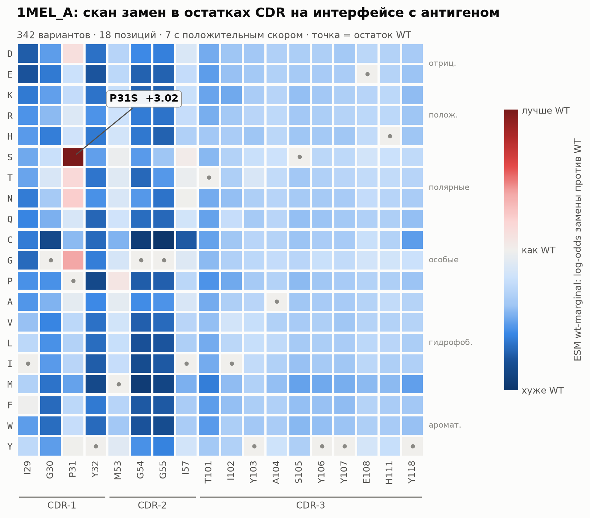

> Historical overview from 14 November 2026. See the [current README](../../README.md) for final results. Relative links have been adjusted for this archive location.

# AI x Antibodies Hackathon (Nucleate Norway, 14.11.2026)

Начать коллеге: [настройка и доступы](../../docs/SETUP.md). Текущий план: [HER2 campaign](../../docs/CAMPAIGN.md).

**Ранжированный черновик на 30:** [CSV с приоритетами](../../output/submission-draft/team-3-ranked-draft30.csv), 10 optimization + 20 denovo, все 30 прошли установленный abguard. [Как отбирали](../../docs/research/ranked-draft-policy.md). Ничего не отправлено.

**Исследовательские пулы для обоих треков:** [CSV, локальные проверки и порядок подачи](../../output/submission-draft/README.md), [два слайда о генерации и оценке](../../output/pipeline-draft/README.md). В CSV 10 вариантов оптимизации и 43 de novo. Это исследовательский пул, не финальная заявка. Установленный `abguard` с комплектной базой допускает 52/53: 11 `novel` и 41 `de_novo`. [Результаты и ограничения](../../docs/research/abguard-validation.md). Актуальное требование: минимум 28, желательно около 30 строк в порядке приоритета; окончательный выбор ещё не отправлен; отправки не было.

**Объяснение на русском:** [два слайда простыми словами, схемы, данные и словарь](../../docs/PIPELINE_EXPLAINED_RU.md). CSV обновлён до шести колонок, включая явный `track`.

**Общий реестр:** [все семейства экспериментов, метрики и решения](../../docs/EXPERIMENT_INDEX.md).

**Последняя серия:** [внешняя проверка SPR](../../docs/research/external-spr-results.md), [72 структурных предсказания на контролях](../../docs/research/template-controls-results.md), [64 генеративных дизайна и 43 локальных допуска](../../docs/research/denovo-scale-results.md), [фиксированные смеси Transformer и ridge](../../docs/research/hybrid-spr-results.md). Структурная постановка не прошла заранее записанный порог воспроизведения WT; массовый refold новой панели не запускали.

**Чекпойнт экспериментов 14 ноября:** [результаты, ограничения и расположение файлов](../../docs/EXPERIMENT_CHECKPOINT.md). [PDF с объяснением](../../output/explainer/her2-intuition.pdf). Новые кандидаты ещё не проверены в лаборатории, конкурсных подач не было.

[Текущая воронка выбора с Mermaid и словарём](../../docs/SELECTION_PIPELINE_RU.md), [парные признаки и AbLang2](../../docs/research/ablang-benchmark.md), [проверка 28 структурных предсказаний](../../docs/research/context-results.md).

**Стенд:** [единый benchmark и два пайплайна](../../docs/BENCHMARK_SYSTEM.md), [предыдущая таблица кандидатов и контролей](../../results/evaluation-board/report.md), [11 нейросетевых экспериментов и 100000 псевдометок](../../docs/research/neural-results.md), [21 повтор OpenDDE](../../docs/research/structural-replicate-results.md), [возможности моделей](../../docs/research/model-capability-audit.md), [компактный срез обучающих данных RFD4](../../docs/research/rfd4-training-data.md).

Разделы репетиции ниже описывают ранние ESM-эксперименты. Их скоры отражают правдоподобие последовательности, а не измеренное улучшение связывания.

Контекст и чек-лист: [CLAUDE.md](../../CLAUDE.md)

## Окружение
Intel Mac → PyTorch максимум 2.2.2, Python 3.12, numpy<2.

```bash
uv venv --python 3.12 .venv
uv pip install --python .venv/bin/python -r requirements.txt
source .venv/bin/activate
```

## Важно: SSL для скачивания весов
У Homebrew-Python нет корневых сертификатов, `torch.hub` падает с `CERTIFICATE_VERIFY_FAILED`.
Перед запуском чего-либо, что качает веса:

```bash
export SSL_CERT_FILE=$(python -c "import certifi;print(certifi.where())")
export REQUESTS_CA_BUNDLE=$SSL_CERT_FILE
```

## Нумерация CDR
`abnumber` требует классический ANARCI с HMMER — не ставится без возни.
Вместо него `anarcii` (чистый Python/PyTorch). Обёртка: [src/cdr_tools.py](../../src/cdr_tools.py).

```bash
.venv/bin/python src/cdr_tools.py
```

## Мини-задача (репетиция пайплайна)
Комплекс антитело-антиген из PDB -> CDR -> остатки на интерфейсе ->
скан точечных мутаций через ESM-2 -> метрики -> CSV в `results/`.

```bash
export SSL_CERT_FILE=$(.venv/bin/python -c "import certifi;print(certifi.where())")
PYTHONPATH=src .venv/bin/python src/mini_task.py 1N8Z B
```

По умолчанию 1N8Z (Fab трастузумаба + HER2). ~1,5 мин на этом ноутбуке,
из них почти всё — загрузка весов ESM-2 в память.

Модули: [src/structure.py](../../src/structure.py) (PDB, цепи, интерфейс),
[src/metrics.py](../../src/metrics.py) (ESM wt-marginals, developability),
[src/cdr_tools.py](../../src/cdr_tools.py) (нумерация, мутации).

Шаблон питча: [PITCH.md](../../PITCH.md).

### График для слайда
```bash
PYTHONPATH=src .venv/bin/python src/plot_scan.py results/1MEL_A_scan.csv
```
Тепловая карта позиция × аминокислота, светлая и тёмная версии PNG.
Ноль палитры привязан к «как у WT», поэтому красные ячейки сразу читаются
как улучшения. Точка — исходный остаток.



### Что показали два прогона
| | 1N8Z (Fab трастузумаба + HER2) | 1MEL (VHH cAb-Lys3 + лизоцим) |
|---|---|---|
| позиций на интерфейсе | 8 | 18 |
| вариантов | 152 | 342 |
| лучший ESM-скор | −1.04 (`F104S`) | **+3.02** (`P31S`) |

Вывод для субботы: на клинически оптимизированном антителе ESM не находит
улучшений — все скоры отрицательные, модель считает WT лучшим в каждой
контактной позиции. На нанотеле из 1996 года есть положительные скоры.
Значит, подход «одиночные мутации по правдоподобию» работает только на
неоптимизированных последовательностях. Если дадут зрелое антитело —
нужны комбинации мутаций или предиктор, обученный на связывании.

## Структура
- `data/` — входные PDB/последовательности
- `notebooks/` — исследования
- `src/` — пайплайн
- `results/` — кандидаты, метрики, графики

## For judges (English)

Start with the [Execution guide](../../docs/EXECUTION_EN.md): models, scoring and filtering for both tracks, reproducibility commands, code and evidence links. The [English presentation](../../output/pipeline-draft/README.md) and [English explanation PDF](../../output/pdf/her2-pipeline-explained-en.pdf) accompany it. The repository is private, so reviewers need access.
