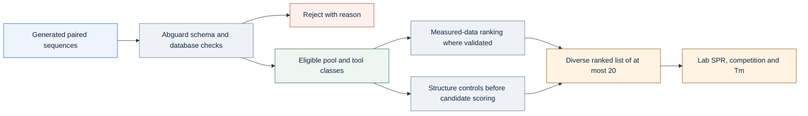

# Installed abguard eligibility benchmark

Checked on 14 November 2026 on the team VM. This is a sequence eligibility benchmark, not a binding, competition or thermostability result. No competition submission was sent.

## Results

The frozen research pool has 10 optimization proposals and 43 locally screened RFD4 designs. Installed `abguard 0.1.0`, with `immunum 2.0.0` and its bundled reference of 610,109 CDRH3s, accepts **52 of 53**. A second strict `team-validate` run accepts all 52 retained rows. The accepted tool classes are **11 `novel` and 41 `de_novo`**. These are the implementation's classes, not independent confirmation of every PDF rule.

`denovo-scale-antibody-k1_23` fails because its numbered CDRH3 `ARVSGYGAMDY` is one edit from `ARGVSGYGAMDY` in `uspto:uspto_AKV99494`, where the tool requires at least two. All 10 intended optimization variants pass. `denovo-scale-her2novel-k1_30`, generated in the de novo arm, is classified `novel` because its length-weighted VH/VL identity to trastuzumab is 0.7056277056.

The WT negative control fails novelty at distance zero, as expected. It has three high-severity motif occurrences. Among the 52 accepted candidates, 47 contain at least one such occurrence. These motifs are separate from hard errors: a motif warning does not establish failed expression, poor binding or low Tm. The ten optimization variants have two or three high-severity occurrences, versus three for WT. Fewer warnings alone are not evidence of improvement.

## Yield over all generated designs

To avoid measuring generator yield only after our local preselection, all 64 existing generated pairs were separately annotated with the same installed tool and reference.

| Generation arm | Generated | Pass installed abguard | Accepted tool classes |
| --- | ---: | ---: | --- |
| antibody checkpoint, seed 20261118 | 32 | 21 (65.6%) | 2 novel, 19 de_novo |
| HER2-novel checkpoint, seed 20261119 | 32 | 26 (81.3%) | 1 novel, 25 de_novo |

Across these 64, 16 rows have an unpaired-cysteine hard error and one has insufficient CDRH3 novelty. The checkpoints use different seeds, so the yield difference is descriptive, not a controlled causal estimate. Our stricter local sequence gate retained 43 before abguard; 42 of those pass abguard. The five additional tool passes outside that local pool are not silently added to the frozen candidate panel. Full-arm and preselected-pool denominators must remain separate.

## What this adds to the benchmark

The generation benchmark can now report eligible yield, failure categories, database distance, assigned class and motif profiles alongside diversity. Evaluate binding rankers on measured held-out SPR, and structural predictors on known complexes, separately. The current 72-pose structural control experiment still fails its WT reproducibility criterion. No common weighted score across these endpoints has been validated, and no thermal ranker is admitted.



## Implementation caveats

The installed tool assigns `novel` when its length-weighted Levenshtein identity to WT is at least 0.70, otherwise `de_novo`. It requires minimum numbered IMGT CDRH3 distance three or two respectively from WT and its reference. This is not the global full-antibody identity search described by the PDF. Its length schema is per chain; our independent preflight also enforces the PDF's stricter combined VH+VL limit of 250, and all current rows meet it. An installed-tool pass does not certify a later organizer database or ruleset, other teams' duplicate submissions, or the final ≤20 list.

**CLI defect in this installed build:** `novelty-report` calls `_reference` without `skipped=False`. `_reference` defaults to skipping the database, even when `--reference-db` is supplied. It reports `is_novel_enough=null` but its summary misleadingly counts those rows as passing. Both diagnostic outputs are preserved in `raw/novelty*.json`; neither supplies our acceptance result. We used `team-validate --all-liabilities`, whose database handling is correct, plus strict validation without `--drop`. No installed package was patched.

## Evidence and replay

- [Summary and input hashes](../../results/abguard-validation/summary.json)
- [Per-design classes, distances and warnings](../../results/abguard-validation/designs.csv)
- [Raw tool annotations and logs](../../results/abguard-validation/raw/)
- [Accepted 52-row research pool](../../output/submission-draft/team-3-abguard-pass.csv)
- [Exact installed package and reference archive manifest](../../results/archives/abguard-installed-package-manifest.json)

The archive contains installed package source and reference data, not an installer or the complete Python environment. `raw/environment.json` records dependency versions and each source/reference hash. Preserve these rather than assuming a version string uniquely identifies the build. The installed metadata identifies the project as `marinegor-apheris/apheris-abguard-demo`.

```bash
# On the original VM, in /home/hackathon/almaz/work/abguard-root-20261114
/home/hackathon/.local/bin/abguard team-validate candidates.csv --all-liabilities --output annotated.json
/home/hackathon/.local/bin/abguard team-validate candidates.csv --drop --output valid.csv
/home/hackathon/.local/bin/abguard team-validate valid.csv --output revalidated.csv
/home/hackathon/.local/bin/abguard team-validate generator-all64.csv --all-liabilities --output generator-all64.json
/home/hackathon/.local/bin/abguard team-validate wt-control.csv --all-liabilities --output wt-control.json

# Replay reconciliation locally without network, tool installation or submission
source .venv/bin/activate
python -m scripts.reconcile_abguard
```

The reconciliation rejects missing annotations, sequence mismatches, unchecked novelty and differences between accepted input rows and the strict CLI revalidation. The accepted CSV preserves the five organizer fields and input order. It exceeds 20 rows and is not the final ranked competition file.
