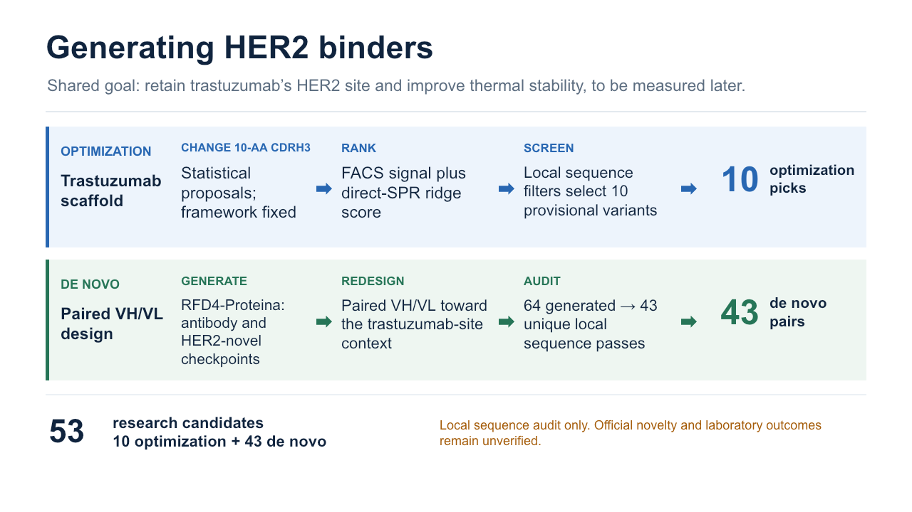
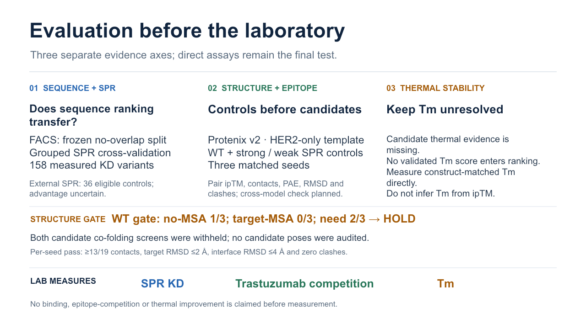

# Two-slide pipeline draft

[Download the editable presentation](her2-hackathon-pipeline-draft-v5.pptx).

Slide 1 shows the optimization and de novo generation branches. Slide 2 separates sequence/SPR evidence, structural controls and unresolved thermal stability before laboratory testing. The deck uses English for the hackathon audience and Russian speaker notes with source references. It describes the current research pool and limitations, not a validated submission.





The 53 candidates comprise 10 optimization variants and 43 locally eligible de novo pairs. The complete no-MSA control passed the fixed WT geometry gate in 1/3 seeds; target-MSA passed in 0/3, against a 2/3 threshold. Both prepared candidate screens were withheld. Official novelty, candidate binding, epitope competition and thermal improvement remain unverified.

The editable source is [pipeline-draft.mjs](../../scripts/presentation/pipeline-draft.mjs). Use the runtime paths returned by Codex `load_workspace_dependencies` for `RUNTIME_NODE`, `RUNTIME_NODE_MODULES` and `RUNTIME_PYTHON`; set `PRESENTATIONS_SKILL_DIR` to the installed Presentations skill. Run the skill's artifact-operation marker before authoring, then use a new `OUTPUT_STEM` for a revision:

```bash
OUTPUT_STEM=her2-hackathon-pipeline-next \
  "$RUNTIME_NODE" scripts/presentation/pipeline-draft.mjs
```

The builder exports two slides, validates the presentation package and layout and renders each finalized slide to PNG. Native PowerPoint rendering was not tested. The reviewed draft SHA-256 is `e262c2b9c152f132977bfd73a0250b1d597fcde58c0d426a0087d2261bf338af`.
