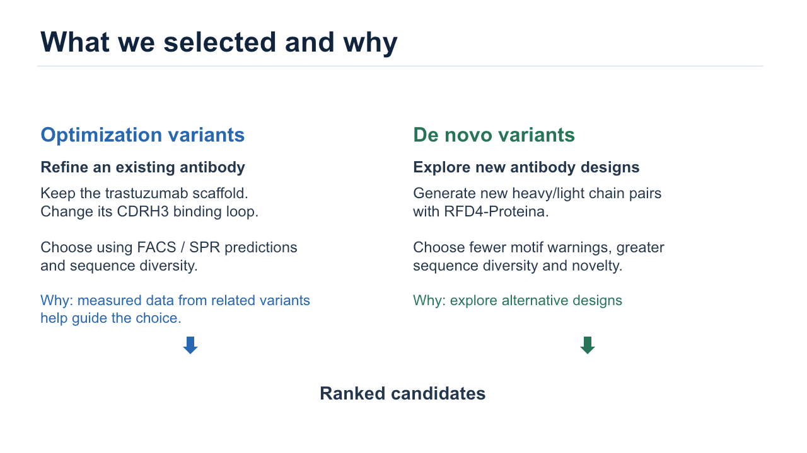
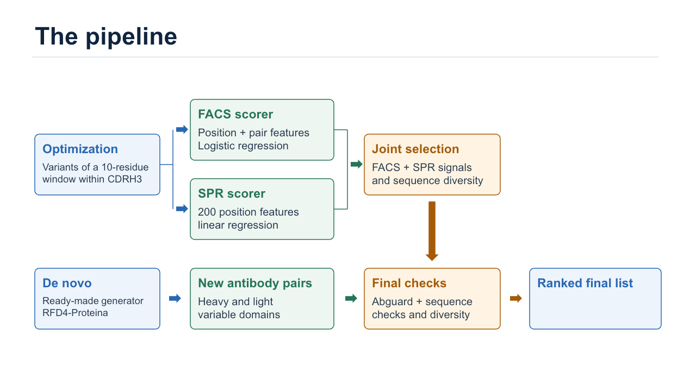

# Final two-slide pitch

[Download the editable PowerPoint](her2-selection-and-evidence-en.pptx).

This is the team's final, manually edited pitch from the 14 November 2026 hackathon, preserved during the 16 November handoff. It contains exactly two slides:

1. What we selected and why.
2. The pipeline.

The original PowerPoint bytes are preserved. SHA-256: `a23b0d7279e1cbfb10acef1546dcb799bf29320af98d1d24231f0d788d88646f`. Previews were rendered from that exact file without saving changes to it. The slide's “linear regression” denotes the positional ridge implementation documented in the [execution guide](../../docs/EXECUTION_EN.md).

The earlier [selection-slide.mjs builder](../../scripts/presentation/selection-slide.mjs) creates the four-slide explanatory draft, not this manually edited final deck. Its extra slides are available in Git history. The legacy builder also writes the numbered previews to this directory regardless of `OUTPUT_STEM`. Run it in a separate checkout to avoid overwriting the final pitch or its previews.

The ranked CSV remains a computational selection. No new candidate's binding, competition or thermal improvement is measured in the archived evidence.
